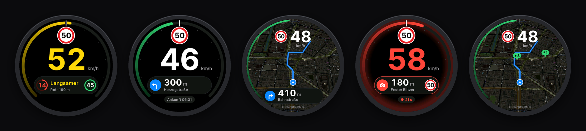
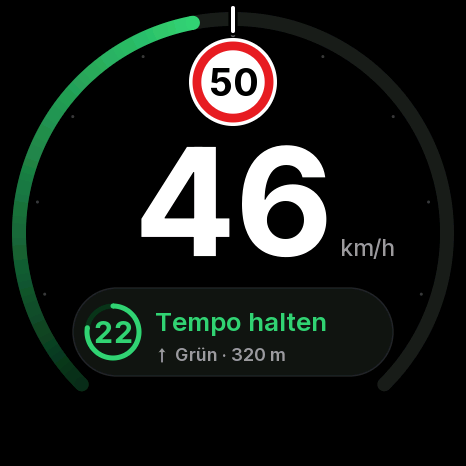
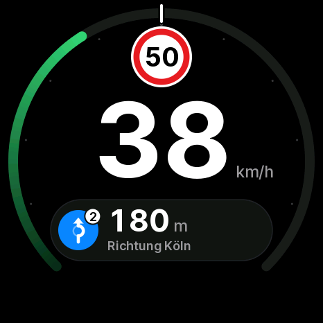
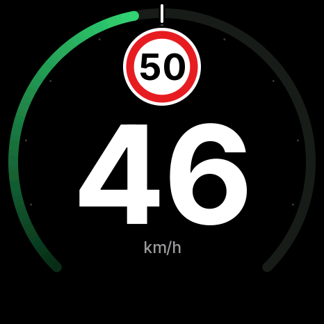
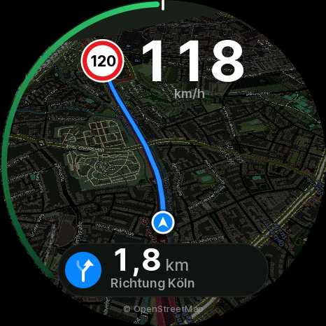
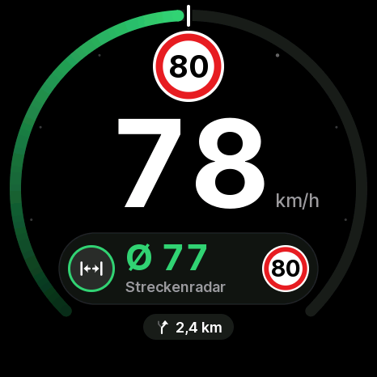
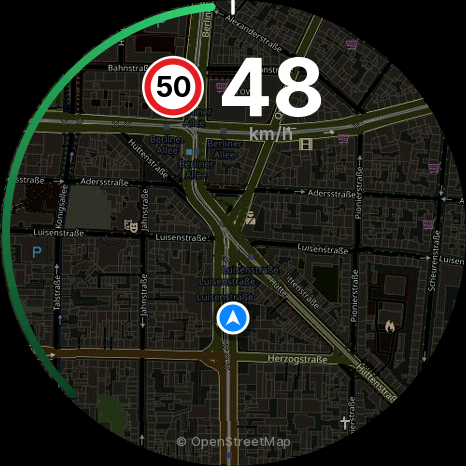
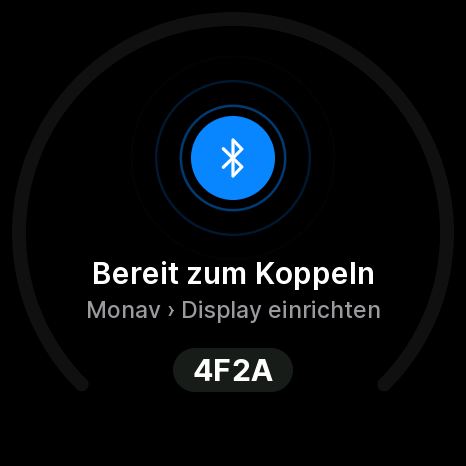
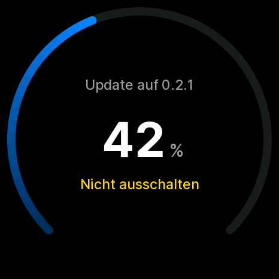
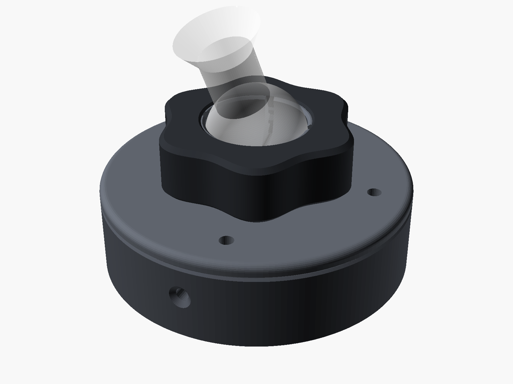

# Monav Display

**A round AMOLED head-up display for the car, driven by your iPhone.**

Speed, the speed limit, speed cameras, traffic-light countdowns, turn-by-turn directions, a moving
map with the route and live charging stations, on a 1.75″ glass that sits on the air vent. The
[Monav](#the-phone-side) app on the phone does the work. The display draws everything itself at up to
30 fps, counts down on its own and keeps going when the Bluetooth link drops for a moment.



<p align="center">
  <a href="https://niklaswa.github.io/monav-display/"><b>⚡ Install from the browser</b></a> ·
  <a href="PROTOCOL.md">Bluetooth protocol</a> ·
  <a href="mount">3D-printed case</a> ·
  <a href="firmware">Firmware internals</a>
</p>

## Features

- **Speedometer ring** whose scale runs to twice the limit, so the limit mark always sits at
  12 o'clock. It fills green, amber when you're up to 5 km/h over, red beyond that.
- **Speed limit sign** (German Zeichen 274) and big tabular digits that ease towards the latest speed.
- **Speed cameras** with their kind, the distance counting down and their limit. If you're too
  fast within 400 m, the rim of the glass pulses red.
- **Traffic-light forecast**: the phase as a ring emptying towards the change, the seconds left, and
  what to do (*slower*, *faster*, *keep speed*, *coast*) with the green-wave speed.
- **Average speed checks**: your average so far against the section's limit.
- **Turn-by-turn directions** with roundabout exits, street names and arrival time.
- **Moving map**: the phone sends map images, the display turns them to the driving direction and lays
  them down in perspective ("Mode 7"), with the route on top and the car dead-reckoned between fixes.
- **Charging stations** on the map with the number of free charge points (or free of all), if a
  charger plug-in is installed in the app.
- **Mount it at any angle**: the picture turns to stand upright, and touch turns with it.
- **Firmware updates over Bluetooth** from the phone, with a probation period: if a new firmware
  crashes or hangs before it has proven itself, the bootloader goes back to the previous one.
- **Gestures**: tap to switch layouts (HUD → focus → map), swipe for brightness, hold 3 s to forget the
  paired phone.
- **German and English**, picked by the phone's language.

<table>
  <tr>
    <td></td>
    <td></td>
    <td></td>
    <td></td>
  </tr>
  <tr>
    <td></td>
    <td></td>
    <td></td>
    <td></td>
  </tr>
</table>

All 36 screens are in [`firmware/preview/`](firmware/preview). They are rendered on the Mac by the
firmware's own code (see [Previews](firmware/README.md#previews)), so they look exactly like the glass.

## Hardware

| | |
| --- | --- |
| Board | [Waveshare ESP32-S3-Touch-AMOLED-1.75](https://www.waveshare.com/esp32-s3-touch-amoled-1.75.htm): 466 × 466 round AMOLED (CO5300, QSPI), CST9217 touch, ESP32-S3 with 16 MB flash and 8 MB PSRAM |
| Power | USB-C from the car |
| Case | 3D-printed, clamps onto a 17 mm ball head like a phone holder ([`mount/`](mount)) |



The case was designed for the vent clip of the Tesla Model 3 Highland's phone holder, but any
17 mm ball joint works. It's three parts and three M2 × 8 screws, printed without supports in PETG.
The parameters (ball size, thread, tolerances) are at the top of the OpenSCAD file.

## Install

**From the browser:** open the [installer](https://niklaswa.github.io/monav-display/) in Chrome or Edge
on a computer, plug the display in with a USB-C data cable and click *Connect and install*. It
flashes the latest release ([ESP Web Tools](https://esphome.github.io/esp-web-tools/)).

**With PlatformIO:**

```bash
cd firmware
pio run -e amoled175 -t upload
```

If the board doesn't show up, hold **BOOT** while plugging it in.

After the first install, the display shows **Bereit zum Koppeln** ("ready to pair") and a four-digit
code. Pair it in the app under *Settings › Display in the car*. From then on the phone connects
whenever the car powers the display, and brings firmware updates along.

## The phone side

The display has no logic of its own for *what* to show: speeds, forecasts, camera alerts,
navigation and map images all come from the phone over Bluetooth LE. The app this was built for is
**Monav**, an iPhone navigation HUD (on TestFlight, coming to the App Store).

The protocol is open and simple: JSON messages for state, a small binary channel for map images,
the route and firmware updates. [`PROTOCOL.md`](PROTOCOL.md) describes all of it, and
[`firmware/tools/ble/monav_ble.py`](firmware/tools/ble/monav_ble.py) is a complete client in Python
(drive simulation, maps, routes, OTA) you can start from. The display doesn't care where its map
pictures come from: Monav renders them with Apple's MapKit, while the previews here use
OpenStreetMap, and a `map` transfer names its source in `attr`.

## Under the hood

- **Two cores, band rendering.** Each frame is drawn in 48-row bands through internal RAM by two
  tasks, one per core, then pushed to the panel by DMA while the next frame is drawn. All shapes are
  anti-aliased from signed distances; there are no LVGL widgets, only a few hundred lines of raster
  code.
- **Mode 7 map.** The map image is stored in 16 × 16 tiles so a rotated scanline stays in the
  cache, and sampled in 16.16 fixed point with one scale per row for the perspective.
- **Safe OTA.** Updates are written while they arrive and checked with SHA-256. The new image boots on
  probation, and a task watchdog plus the bootloader's rollback catch a bad one.
- **Host previews and checks.** The portable core (protocol, app state, renderer) compiles for macOS.
  169 checks plus every screen are rendered on each run, drawn both band by band and in one pass,
  and the two must match pixel for pixel.

More in [`firmware/README.md`](firmware/README.md).

## Repository

```
PROTOCOL.md      the Bluetooth protocol, version 1
firmware/        PlatformIO project (Arduino on ESP32-S3), previews, host checks, BLE test client
mount/           OpenSCAD case, STLs, Bambu Studio projects
docs/            the web installer and how it is built
```

## Credits

- The panel bring-up (CO5300 init, RAM offset, reset timing) comes from
  [ESP32-Plane-Radar](https://github.com/MatixYo/ESP32-Plane-Radar) by MatixYo (MIT).
- [LovyanGFX](https://github.com/lovyan03/LovyanGFX) (FreeBSD),
  [NimBLE-Arduino](https://github.com/h2zero/NimBLE-Arduino) (Apache 2.0),
  [ArduinoJson](https://github.com/bblanchon/ArduinoJson) (MIT),
  [SensorLib](https://github.com/lewisxhe/SensorLib) (MIT),
  [BOSL2](https://github.com/BelfrySCAD/BOSL2) for the case (BSD 2-Clause).
- [Inter](https://rsms.me/inter/) by Rasmus Andersson (SIL OFL 1.1), baked into the firmware's fonts.
- Sample maps © [OpenStreetMap](https://www.openstreetmap.org/copyright) contributors (ODbL).

## License

[MIT](LICENSE) © 2026 Niklas W.
