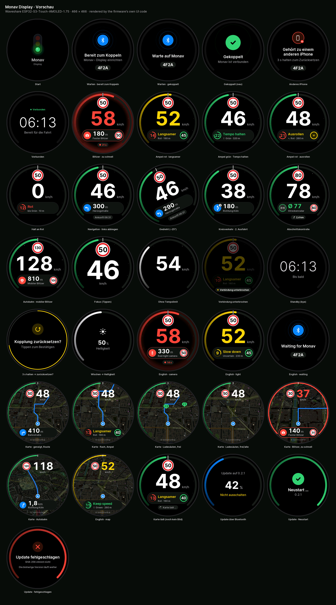
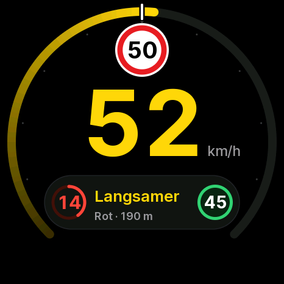
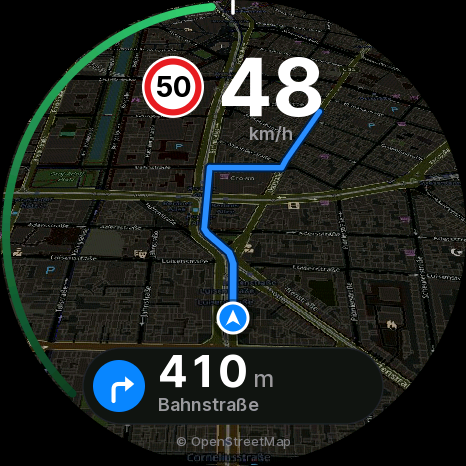

# Monav Display — firmware

How the firmware works, how to build it and how to test it. For what the display does and how to
put one together, see the [README one level up](../README.md); for the Bluetooth protocol,
[`PROTOCOL.md`](../PROTOCOL.md).



## Hardware

**Waveshare ESP32-S3-Touch-AMOLED-1.75**

| | |
| --- | --- |
| Panel | 1.75" round AMOLED, 466 × 466, CO5300 controller on QSPI |
| Touch | CST9217 capacitive (I²C, interrupt line) |
| SoC | ESP32-S3R8: 16 MB flash, 8 MB octal PSRAM, BLE 5 |
| Button | BOOT (GPIO 0), used for the pairing reset |
| Power | USB-C, from the car's USB port; no battery handling |

Pins live in [`include/config.h`](include/config.h). The panel bring-up (custom
CO5300 init list, 6-column RAM offset, the long reset pulse, full-width pushes because the panel
drops writes at odd x/width) comes from the plane-radar-amoled project, where it is proven on this
board.

The display has no sleep mode: it runs as long as the car powers the USB port, and Monav's pending
BLE connection picks it up as soon as it boots.

## Build and flash

Needs [PlatformIO](https://platformio.org) (CLI or the VS Code extension).

```bash
cd firmware
pio run -e amoled175                 # build
pio run -e amoled175 -t upload       # build and flash over USB-C
pio device monitor                   # serial log, 115200 baud
```

If the upload cannot find the board, hold **BOOT** while plugging in the cable (download mode),
flash, then press **RST** or replug.

The version lives in one place: `kFirmware` in `src/core/app.h` (Monav's bundling script
reads it from there; `welcome` and the `info` characteristic report it).

Build options (in `platformio.ini` / `include/config.h`):

| | |
| --- | --- |
| `MONAV_QSPI_HZ` | QSPI clock, default 80 MHz (40 MHz is what plane-radar runs, if a board ever shows a scrambled picture) |
| `MONAV_PUSH_DMA` | default 1: frames go to the panel through two internal 16-row DMA buffers; 0 pushes the PSRAM sprite directly (slower, keeps core 0 busy) |

Environments:

| | |
| --- | --- |
| `amoled175` | the release firmware |
| `amoled175-dev` | development only: also accepts the Mac test client's token (without touching the pairing), honours `{"t":"dev","layout":…}`, and advertises as **Monav Dev XXXX** under a service UUID one digit off, from a random static address — so the paired iPhone leaves it to the test client |
| `amoled175-demo` | development only: no BLE; a scripted drive on an embedded sample map goes through the real app and transfer path, cycling all layouts — for measuring frame times on the board; also times the drawing primitives at start |
| `amoled175-crashtest` | the dev build, but it aborts 6 s after boot: flashed over the air, it shows the bootloader rolling back |
| `amoled175-hangtest` | the dev build, but its drawing loop hangs 6 s after boot: flashed over the air, it shows the task watchdog catching the hang and the bootloader rolling back |

The fonts are Inter (SIL OFL), baked into anti-aliased VLW bitmaps in `data/fonts/` and
embedded into the firmware. They are checked in; to change sizes or weights edit the table in
`scripts/build_fonts.py` and run it (needs Inter at `~/Library/Fonts/`, Pillow with
libraqm and fontTools).

## First pairing

1. Power the display. It shows **Bereit zum Koppeln**, the hint *Monav › Display einrichten*
   and a four-digit id such as **4F2A** (the last two bytes of its Bluetooth address).
2. In Monav open **Einstellungen › Display im Auto › Display einrichten**. The setup opens the
   iOS accessory sheet (AccessorySetupKit); from iOS 26.1 it lists each display with its id —
   pick the one with the same id.
3. The display answers with a green check, **Gekoppelt**. Monav keeps a pending connection from now
   on, so the display connects (and wakes Monav in the background) whenever the car powers it —
   since iOS 26 even after Monav was swiped out of the app switcher.

There is no Bluetooth bonding: pairing is a token Monav sends in `hello`, which the display keeps in
NVS. Reflashing never leaves a stale bond on the phone. A display paired with one iPhone shows
**Gehört zu einem anderen iPhone** to every other one, with the hint how to reset it.

## Using it

| Gesture | What it does |
| --- | --- |
| Tap | Drive HUD → focus layout (speed and limit only, bigger) → map → HUD; remembered, and reported to Monav with `status` (Monav renders map images only in the map layout) |
| Swipe left / right | Brightness down / up in 10 % steps (saved, and reported to Monav with `status`) |
| Hold 3 s | **Kopplung zurücksetzen?** — a tap within 5 s forgets the paired iPhone |
| BOOT held 3 s | Forgets the paired iPhone without asking |

A ring fills around the edge while a finger rests on the glass, so the 3-second hold is visible.
After a reset the display drops the current connection; the next `hello` pairs it anew.

The display's own texts are German; Monav's `hello` with `"lang":"en"` switches them to English
(remembered across restarts).

## Screens

| | |
| --- | --- |
| Start | Monav's traffic light lights up red, amber, green |
| Waiting | Bluetooth pulse, **Warte auf Monav** and the id; when not paired yet **Bereit zum Koppeln** and where to pair in the app |
| Gekoppelt | Green check animation after a fresh pairing |
| Denied | **Gehört zu einem anderen iPhone** and *3 s halten zum Zurücksetzen* |
| Connected | The phone's clock, *Bereit für die Fahrt* — paired and connected, no drive yet |
| Drive HUD | While `v` messages arrive, see below |
| Link lost | No `v` for more than 3 s, or the phone disconnected mid-drive: the HUD dims and shows **Verbindung unterbrochen**; after 20 s it goes back to waiting (or connected) |
| Standby | After `bye`: the clock and **Bis bald**; dims after a minute |
| Map | The map layout, see below; until an image under the car has arrived, the HUD with a **Karte lädt …** chip |
| Update | A firmware update over Bluetooth: progress around the glass, percent, **Nicht ausschalten**, then **Neustart …** — or **Update fehlgeschlagen** and the old version keeps running |

### The drive HUD



- **Ring** — the speedometer, 270° open at the bottom. The scale runs to twice the limit, so the
  white limit mark always sits at 12 o'clock: the left half is legal, the right half is not. Filled
  green up to the limit, amber up to 5 km/h over it, red beyond. Without a known limit the scale is
  0–160 km/h and the fill is white. Dots every 10 (or 20) km/h, larger every 50.
- **Limit sign** — German Zeichen 274 at the top, under the limit mark.
- **Speed** — big tabular digits, white (amber / red when over the limit), easing smoothly towards
  the latest `v`.
- **Card** — one context card in the lower third, by priority:
  1. **Speed camera** within 1 km: icon by kind, distance counting down, the camera's limit. Within
     400 m and too fast, the edge of the glass and the card pulse red.
  2. **Average speed check** (`sec`): Ø so far against the section's limit.
  3. **Traffic light** within 400 m: the phase as a ring emptying towards the change with the
     seconds inside, what to do (*Langsamer* / *Schneller* / *Tempo halten* / *Ausrollen*), the
     green-wave speed as a green badge, the lane arrow, state and distance.
  4. **Next turn** while navigating: arrow by manoeuvre (roundabouts with the exit number), distance,
     road; the arrival time in the chip below when nothing else is there.
- **Chip** — the second-priority item, small, below the card.

Countdowns run on the phone's clock (offset filtered as [PROTOCOL.md](../PROTOCOL.md) describes); distances run down
with the latest speed since the scene's `at`.

### The map layout



- **Map** — the MapKit image Monav renders around the car (`map` transfer, PROTOCOL.md), turned so
  the driving direction is up, the car at 68 % of the height. In perspective by default (each
  scanline its own scale, the road ahead running into the distance; `cfg.tilt` false lays it flat).
  The image is darkened slightly once when it is decoded, so the overlays stand out.
- **Car** — `v`'s `lat`/`lon`/`hdg`, run on along the heading with the speed between the fixes
  (they change about once a second and are repeated in between) and eased towards each new fix;
  the heading eases too. A jump of more than 150 m is taken at once.
- **Route** — the `route` line from the car on (what is driven is cut off), blue with a dark casing,
  narrower into the distance.
- **Overlays** — limit sign and speed at the top, the context card (smaller) at the bottom, a thin
  speed ring along the edge (red and pulsing when a camera is close and the car too fast), and
  the credit for the picture: the `attr` of the `map` transfer, "© Apple Maps" when it has none.
- **Charging stations** — pins with a bolt and the free charge points (or free/all), green while
  one is free, grey when full, from `chg` (firmware 0.2.4).
- No image yet, or the car off it: the HUD's ring and layout with a calm **Karte lädt …** chip.

## Firmware updates over Bluetooth

Monav sends a new firmware as an `ota` transfer ([PROTOCOL.md](../PROTOCOL.md)): the display opens the other app
partition (two 6 MB slots), writes the bytes as they come — sequentially, erasing sector by sector,
so nothing ever blocks the link for seconds — and only acknowledges bytes that are in flash. On
`end` it checks the SHA-256 of the whole image and the image itself, makes the new partition the
boot partition, answers `done` and restarts 600 ms later. The restart is an `esp_timer` one-shot,
armed before `done` goes out: nothing the link, the transfer task or the serial port do can hold
it up. (Up to 0.2.1 the transfer task restarted after a `Serial.flush()`, which never returns when no
USB host reads the port — in the car the glass stayed on **Neustart …** until the power went.)

The new firmware starts **on probation** (the bootloader's app rollback, which the precompiled
Arduino bootloader has enabled): it confirms itself once it has drawn its first frame, advertises and
has run for 15 s. A crash or a hang before that and the next start goes back to the previous
firmware. A lost connection, `abort` or a bad SHA-256 leave the running firmware as it is.

Hangs are caught by the task watchdog (5 s, then a reset). It watches the drawing loop (`ui`, which
waits for the second drawing task and the push every frame, so a hang in either stops it too) and
the transfer task (fed while it decodes a map). It does not watch core 0's idle task, as the
framework does by default: core 0 draws half of every frame, pushes the previous one (LovyanGFX
waits for the SPI DMA in a busy loop) and writes flash or decodes maps, so under load it is never
idle for long — up to 0.2.1 that starved the idle task for 5 s and reset the display in the map
layout and during updates although nothing hung. The start-up log names the cause of the last
reset: `boot: reset reason task watchdog` / `crash` / `restart` / `power on`.

The serial log tells which slot runs and in what state: `ota: running app1 (on probation)` …
`ota: firmware 0.2.0 confirmed`.

Tested on the board with the Mac test client: the 1.5 MB image in 104–118 s (12.5–14 kB/s, no
resends), restart, `welcome`, confirmed 15 s later; a wrong SHA-256, `abort` and a dropped
connection all leave the running firmware; and the `amoled175-crashtest` image, sent the same way,
crashed on probation and the bootloader went back to the previous slot on the next start
(`ota: running app0 (on probation)` → `crash test: abort() on purpose` → `ota: running app1
(confirmed)`). While flash is written the update screen runs at 17–23 fps with single frames up to
~250 ms (the flash writes stall the caches of both cores).

Again for 0.2.2: no watchdog reset in any update (the 0.2.1 code reset 3 times out of 3, about
20 s into the transfer); `done` → restart 600 ms later by the serial log, also with the phone gone
right after `end`, also during a drive in the map layout with a new map and route every 5 s, and also
with the USB data line detached as on a car charger (an experiment build cut the D+ pull-up: the
0.2.1 restart path then only restarted because the watchdog fired, the 0.2.2 one restarted within
about a second, `boot: reset reason restart`). The `amoled175-hangtest` image hung on probation, the
watchdog reset it 5 s later (`task_wdt: - ui (CPU 1)`) and the bootloader went back to the
previous slot.

A USB upload (`pio run -t upload`) always writes slot `app0` and resets the boot selection to it;
the pairing (NVS) is kept. Never `erase_flash` unless the pairing should go too.

## Previews

The UI code only depends on a 466×466 LovyanGFX sprite and a state struct, so it also compiles for
the Mac. The preview tool feeds scripted phone messages through the real framing, JSON parser and
app logic, renders each scenario with the real renderer and writes PNGs masked to the round glass:

```bash
cd firmware
tools/preview/render.sh          # -> preview/*.png, preview/overview.png, preview/icons.png
tools/preview/render.sh -v       # also logs the app and every message it sends to the phone
```

Needs the Xcode command line tools and SDL2 headers (`brew install sdl2-compat`; LovyanGFX's host
platform is SDL, but no window is opened). The first run compiles LovyanGFX once into
`.pio/preview/`. Before rendering it runs the host checks in `tools/preview/checks.cpp` (framing
edge cases, parsing, pairing and reset flows, time sync, timeouts, the bulk transfer bookkeeping,
dead reckoning, the map projection) and stops if any fails. Every scenario is drawn twice — band by
band like on the device and straight into the canvas — and must come out identical.

The map scenarios use the samples in `tools/preview/maps/` (`sample-*.jpg` with a `.json` of
`lat`, `lon`, `mpp`, `attr`), decoded by the firmware's own decoder; without them a synthetic map
stands in. They are rendered from OpenStreetMap's standard tiles, turned dark
(`uv run tools/preview/maps/render_samples.py`); Monav itself sends MapKit images.

To add a scenario, add a block to `runAll()` in `tools/preview/preview.cpp`.

## Testing over Bluetooth from the Mac

`tools/ble/monav_ble.py` speaks the protocol from the Mac (Python with
[bleak](https://github.com/hbldh/bleak)) against a display running `amoled175-dev`:

```bash
uv venv /tmp/monav-ble && uv pip install --python /tmp/monav-ble/bin/python bleak
cd firmware
/tmp/monav-ble/bin/python tools/ble/monav_ble.py info
/tmp/monav-ble/bin/python tools/ble/monav_ble.py drive --seconds 40     # map + route + a drive along it
/tmp/monav-ble/bin/python tools/ble/monav_ble.py ota .pio/build/amoled175-dev/firmware.bin --version 0.2.0-dev
/tmp/monav-ble/bin/python tools/ble/monav_ble.py drive --seconds 600 --map-every 5 [--off-image]  # a new map + route every 5 s
/tmp/monav-ble/bin/python tools/ble/monav_ble.py ota .pio/build/amoled175-crashtest/firmware.bin   # rollback after a crash
/tmp/monav-ble/bin/python tools/ble/monav_ble.py ota .pio/build/amoled175-hangtest/firmware.bin    # rollback after a hang
/tmp/monav-ble/bin/python tools/ble/monav_ble.py ota … --with-drive --map-every 5 --stay  # update in the map layout, maps still coming
/tmp/monav-ble/bin/python tools/ble/monav_ble.py ota … --drop-after-end              # the phone gone before `done`
/tmp/monav-ble/bin/python tools/ble/monav_ble.py ota … --corrupt-sha                 # must be refused
/tmp/monav-ble/bin/python tools/ble/monav_ble.py ota … --abort-at 200000 [--abort-op] # disconnect / abort
```

It keeps to the protocol's flow control (32 KiB beyond the last `got`, `from`, 3 s timeout) and waits
for CoreBluetooth's `canSendWriteWithoutResponse` before every bulk write — without that,
CoreBluetooth silently drops writes once its queue is full (the display then asks for the gaps
with `from`, which is how that path got tested). The iOS app must do the same.

## How the firmware is built

```
firmware/
  include/config.h            pins, panel geometry, timings
  include/hardware/           LovyanGFX device for the CO5300 (from plane-radar)
  src/core/                   portable: protocol (framing, JSON), bulk transfer bookkeeping, app
                              state machine, gestures, time sync, dead reckoning, strings (de/en)
  src/ui/                     portable: renderer, map renderer and JPEG decoding, icons,
                              anti-aliased raster primitives, VLW text
  src/device/                 ESP32 only: display pipeline, touch, NimBLE link, transfers (OTA,
                              map, route), NVS, demo + benchmark (dev builds)
  src/main.cpp                tasks and glue, the firmware's probation
  tools/preview/              host build: previews and checks
  tools/ble/                  Mac test client
```

| Task | Core | |
| --- | --- | --- |
| `ui` | 1 | app logic; draws half of each frame's bands |
| `band` | 0 | draws the other half (whichever band is next) |
| `push` | 0 | pushes the finished frame to the panel through DMA, started on the tearing-effect edge |
| `bulk` | 0 | writes firmware updates to flash, decodes map images into the spare map buffer (not while an update is written) |
| `touch` | 1 | CST9217 interrupt → finger samples |
| NimBLE host | 0 | reassembles and parses writes, takes bulk bytes, queues events for `ui` |

**Drawing.** Two full frames live in PSRAM: one is drawn while the other goes out over QSPI. A frame
is drawn in 48-row bands through internal RAM — per-pixel work in PSRAM was the bottleneck — by two
tasks, one per core, each taking the next band not yet drawn; a finished band goes into the frame
in one copy. Everything is drawn straight into the band from anti-aliased spans and signed
distances (`src/ui/raster.cpp`, square roots per row, exact distances only on edge pixels; arcs
with a polynomial `atan2`), text is blitted from the VLW fonts (`src/ui/text.cpp`). The map sampler
steps through the image in 16.16 fixed point; the image is stored in 16×16 tiles with a spare
tile per row of tiles (at any heading a glass row then stays within a few cache lines, and tile
rows do not alias in the 32 KiB cache).

**Rotation.** A display that hangs at an angle on its ball joint gets its picture turned back
upright (`cfg.rot`, firmware 0.2.3). The renderer always draws upright; the push task fills each
16-row DMA band by sampling the finished frame turned by the angle (nearest pixel, 16.16 fixed
point, only inside the round glass) instead of copying it (`src/ui/rotate.cpp`). Touches are
turned back the same way before they reach the gestures.

Measured on the board (demo build, 80 MHz QSPI, DMA push; frames per second):

| Layout | fps | draw | |
| --- | --- | --- | --- |
| Waiting | 30 | 24 ms | capped at the 33 ms frame interval |
| HUD (light card) | 24–26 | 34–38 ms | |
| Focus | 25–29 | 31–37 ms | |
| Map, perspective, route, card | 17.6–18 | 54 ms | 18.1–19.1 with the Mac test client driving over BLE |
| Map, flat, camera alert | 15.9–16.9 | 57–61 ms | the slowest case |
| Map, a new 1024² map + route every ~15 s over BLE | 14.8–16.7 | 57–66 ms | 10 min, 40 images decoded alongside the drawing (0.2.2) |

Every 10 s (and when the screen changes) the serial log prints them:

```
frame [map]: 18.0 fps, draw 53.6 ms avg / 56.8 max (clear 0.4, copy 8.7, map 33.5, route 4.9, text 3.5, ring 10.0, card 9.8), push 27.7 ms avg / 30.5 max, loop max 58.3 ms, TE sync (0 misses), heap 73 kB, psram 2632 kB, mtu 23, interval 0.00 ms
```

(the parts in brackets are summed over both drawing tasks).

## Troubleshooting

| Symptom | What to check |
| --- | --- |
| Black screen after flashing | Serial log: `display: panel init failed` or `no PSRAM for the frame buffers` (PSRAM needs `memory_type = qio_opi`). The panel starts dark and only gets its brightness after the first frame. |
| Scrambled picture | Set `MONAV_PUSH_DMA` to 0 and/or `MONAV_QSPI_HZ` to 40 MHz. |
| A seam / tearing | Log says `no tearing-effect signal on the TE pin`: the TE line (GPIO 13) is not pulsing; frames go out unsynchronised. |
| Low frame rate | Look at the `frame` line: `draw` is the renderer (both cores), `push` the transfer to the panel. |
| The map never shows | Layout `map`? Log `map: #… decoded`? A `map` error answer names the reason (size, memory, not a baseline JPEG). The car must be on the image (24 px margin). |
| An update rolled back | The new firmware crashed or hung within its first 15 s: the log of the next start shows `ota: running app0`, the phone sees the old version in `welcome`. |
| Resets now and then | `boot: reset reason …` in the start-up log: `task watchdog` means the drawing loop or the transfer task stood still for 5 s (the panic before it names the task and a backtrace — decode it with `xtensa-esp32s3-elf-addr2line -pfiaC -e .pio/build/amoled175/firmware.elf <addresses>`). |
| Stays on **Neustart …** after an update | Firmware 0.2.1 or older without a USB host (see above); power-cycle it — the new firmware is already the boot partition. Fixed in 0.2.2. |
| `ota … error begin ESP_ERR_OTA_ROLLBACK_INVALID_STATE` | A firmware still on probation cannot take the next update; wait the 15 s. |
| Monav does not find the display | Log `ble: advertising as "Monav Display XXXX"`? Bluetooth on the phone? A display paired to another phone shows **Gehört zu einem anderen iPhone** — reset it. |
| "Gehört zu einem anderen iPhone" | Hold a finger on the glass 3 s and tap, or hold BOOT 3 s. |
| Swipe changes brightness the wrong way | Flip `kTouchMirrorX` in `include/config.h`. |
| Touch does nothing | Log `touch: no controller found` — BOOT still works for the reset. |
| The 3 s hold never asks | The controller may stop reporting a resting finger; `kTouchReleaseGapMs` in `config.h` ends a contact after that much silence. |
| Clock in the wrong time zone | Monav can send `tz` in `hello`/`cfg`; without it the display assumes German time (CET/CEST). |
| Upload fails, port busy | Close the serial monitor; or hold BOOT while plugging in. |
