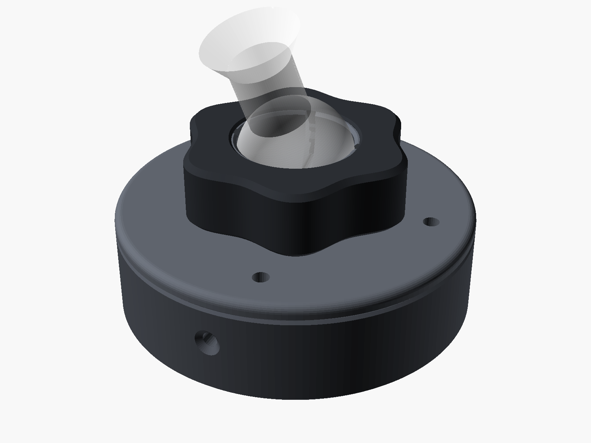
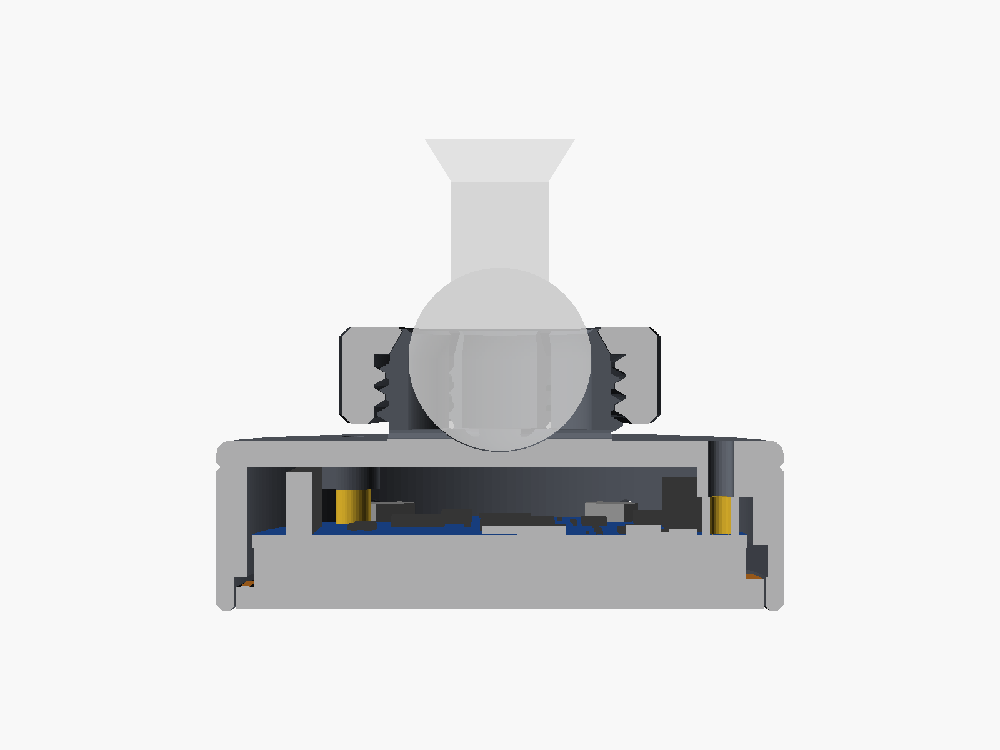

# Display mount

A printed case for the Waveshare ESP32-S3-Touch-AMOLED-1.75 that clamps onto the 17 mm ball head
of the Model 3 Highland vent clip (the clip that comes with the magnetic phone holder; the magnetic
holder itself is not needed). It works like the phone holder: a slotted socket snaps over the ball
and a knob on its thread squeezes the fingers shut.



| Part | What it does |
| --- | --- |
| ring | Frame around the glass. Opening for the USB-C plug, pin holes for BOOT and PWR, three ears the board is screwed to. |
| lid | Back cover with the threaded ball socket (six fingers, 30° clamp cone). |
| nut | Six-lobed knob. Its lip slides over the ball, its cone presses the fingers onto it. |

The whole thing is 52.7 mm across and 26 mm deep from the glass to the top of the knob.



## What you need

- 3 × M2 × 8 screws (cap or pan head). They go through the lid and the ears into the board's own
  3.5 mm SMT standoffs. Don't use longer ones: an M2 × 10 reaches through the standoff towards the
  display.
- PETG (or ASA if the printer is enclosed). **Not PLA**: the case sits in the vent's air stream,
  and a car parked in the sun gets hotter than PLA can take; the nut then creeps and the joint
  loosens.

## Printing

Open [`monav-mount.3mf`](monav-mount.3mf) in Bambu Studio. It is a project for the A1 (0.4 mm
nozzle, textured PEI plate) with the three parts already placed and turned the right way up (ring
on its back face, lid on its inner face, knob on its thread end). No supports.

- 0.20 mm Standard with two changes, which Studio shows as modified:
  - Avoid crossing walls on. Without it the nozzle travels straight across the knob's bore on
    every layer and leaves it full of strings.
  - 3 walls, so that the socket fingers print solid.
- The filament preset is eSUN PLA+, which is fine for a fit print. For the one that goes in the car,
  switch it to PETG; the two changes belong to the process preset and stay.
- About 35 min and 17 g in PLA+, 40 min in PETG Basic. 0.16 mm gives cleaner threads.

**Reprinting only the socket:** [`monav-socket.3mf`](monav-socket.3mf) holds just the lid and the
knob (the ring stays). The first version's socket had four fingers that were 4 mm thick at the root;
the knob couldn't bend them round the ball by hand. Since November 2026 the socket has six fingers
with an even 1.7 mm wall down to a spherical cup at the root, a 23 mm thread and 2 mm more knob
travel. An old knob doesn't fit the new thread.

**Print the test first:** [`monav-test.3mf`](monav-test.3mf) is the same socket on a small disc plus
the knob, with the same settings (about 20 min, PLA is fine for this). On the real ball:

1. The knob slides over the ball onto the clip's neck.
2. The socket snaps on with a light click and turns freely.
3. Screwed up, the knob locks the joint within about half a turn after it starts to bite.

If the knob is too tight on the thread, raise `$slop` by 0.02 (too loose: lower it). If the ball
doesn't snap in, lower `ball_wrap`; if it falls out with the knob loose, raise it.

## Assembly

1. Push the board into the ring from the front, components first, until the glass sits in its
   recess. It only goes in one way round: the USB-C port to the big side opening, the three
   standoffs onto the three ears. The glass doesn't touch the case; the board rests on the ears.
2. Put the lid on and screw it down with the three M2 × 8 screws. Snug is enough. These screws are
   all that holds the board and the lid: each one clamps lid and ear onto a standoff.
3. Slide the knob onto the clip's ball, lip first (the wide, threaded side faces the display).
4. Press the socket onto the ball until it clicks, then screw the knob up onto the socket's thread
   until the joint holds.

To change the angle, loosen the knob a quarter turn, tilt, tighten again. The joint turns all the
way round, so the cable can leave in any direction, and tilts 30–40° each way, depending on how
thick the clip's neck is under the ball.

BOOT (pairing reset, held 3 s) and PWR are reached through the two small holes on the side with a
paper clip. They are deliberately not flexing buttons in the wall: you hold the rim to adjust the
display, and a button there would be easy to keep pressed long enough to forget the paired iPhone.
The micro SD slot is covered; the firmware doesn't use it.

## Changing the model

Everything comes from [`monav_mount.scad`](monav_mount.scad) (OpenSCAD with
[BOSL2](https://github.com/BelfrySCAD/BOSL2) in the OpenSCAD library folder). The parameters at the
top cover the ball (`ball_d`, `ball_gap`, `ball_wrap`), the thread (`thread_d`, `thread_pitch`,
`$slop`) and the buttons; `part` picks what is shown or exported (`assembly` and `section` are for
looking, the others are print-oriented).

```bash
for p in ring lid nut test_socket; do openscad --backend=manifold --export-format binstl -D "part=\"$p\"" -o stl/monav-$p.stl monav_mount.scad; done
python3 make_3mf.py
python3 bambu_project.py
```

`make_3mf.py` packs the STLs into plain 3MFs; `bambu_project.py` turns them into Bambu Studio
projects with the settings above. It resolves the system profiles itself, because the Bambu Studio
CLI doesn't follow their `inherits` chain and falls back to built-in defaults instead.

[`board_dummy.scad`](board_dummy.scad) is the board as boxes, generated from Waveshare's STEP model
(`ESP32-S3-Touch-AMOLED-1.75-3D.zip` on the Waveshare wiki). The case was checked against it: the
board slides in from the front and touches the case only at the three standoffs, the header has
0.5 mm under the lid. The model's numbers that matter, behind the glass front:

| | Depth | Note |
| --- | --- | --- |
| Glass | 0–2.05 | Ø 48.96; the panel's flex cable folds round the edge down to 2.7 at one spot |
| PCB | 5.70–6.90 | Ø 46.02 |
| USB-C | 5.99–10.15 | stands 0.8 mm proud of the PCB edge |
| Standoffs | to 10.40 | 3 × M2, at (0, −20.5) and (±13.75, 14.7) seen from behind |
| JST connectors | to 11.70 | either side of the top standoff |
| 8-pin female header | to 12.70 | the tallest part, sets the lid's position |
